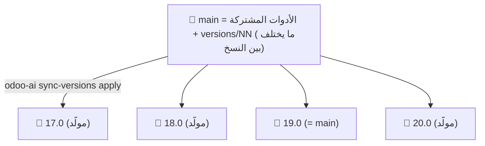

# Odoo Studio & CI Pro — Master Architecture & Plan Index
# فهرس خطة العمل والمعمارية المركزية لمنظومة أودو الموحدة

**Author & Ownership:** [HosamAE](https://github.com/HosamAE)  
**Master Repository:** [https://github.com/HosamAE/odoo_plan](https://github.com/HosamAE/odoo_plan)  
**Target Odoo Versions:** 17.0, 18.0, 19.0, 20.0  
**License:** MIT License  

---

## 1. الرؤية العامة وهيكل المنظومة (Master System Topology)

تم تصميم المنظومة لتوفير **بيئة تطوير معزولة، سريعة، وموحدة** تفصل تماماً بين محرك السيرفر والأدوات المشتركة (The Tools Hub)، وبين كود وموديولات المشاريع الخاصة (Isolated Business Projects):

```text
C:\odoo\
├── bin\                                        # النظام الموحد للتشغيل (odoo-ai launcher)
│
├── odoo<NN>\                                   # بيئة تشغيل الإصدار (Core Engine & Shared Hub)
│   ├── odoo\                                   # كود سورس أودو الرسمي
│   ├── venv\                                   # بيئة بايثون الافتراضية المعزولة
│   ├── odoo.conf                               # إعدادات السيرفر الافتراضية
│   └── tools\                                  # مستودع الأدوات المركزي (odoo_plan)
│       ├── cli.py                              # أداة التحكم الشاملة (odoo-ai CLI)
│       ├── db_fast.py                          # محرك اختبارات الـ 3 ثوانٍ (Template DB Clone)
│       ├── db_snap.py                          # مدير الـ Snapshots والاسترجاع في ثانية واحدة
│       ├── xpath_lint.py                       # فاحص الواجهات السكوني (XML/XPath Linter)
│       ├── i18n_sync.py                        # محرك الترجمات المتعددة (PO/POT Sync Engine)
│       ├── scaffold_plus.py                    # مولد الموديولات المطابقة لمعايير أودو الحديثة
│       ├── doctor.py                           # فاحص صحة البيئة والشبكة والبورتات
│       ├── docs\                               # الفهرس الشامل وخرائط الطريق المركزية
│       └── vscode-extension\                   # إضافة VS Code الرسمية (HosamAE.odoo-ci)
│
└── ProjectsOdoo<NN>\                           # مجمع المشاريع المستقلة كلياً
    └── <ProjectName>\                          # مستودع Git الخاص بكل مشروع
        ├── <ProjectName>.code-workspace        # مساحة العمل التي تربط المشروع بمحرك الإصدار
        ├── <ProjectName>.conf                  # إعدادات السيرفر وبورت المشروع المخصص (xxyy)
        ├── odools.toml                         # إعدادات الـ Language Server للمشروع
        ├── .mcp.json                           # ربط المشروع بخادم المعرفة (Knowledge Graph)
        ├── plan\                               # مجلد خطة العمل وجدولة المهام الخاصة بالمشروع
        │   ├── ROADMAP.md                      # خارطة الطريق ومراحل التطوير المرتبة
        │   ├── TASK_QUEUE.md                   # قائمة المهام التنفيذية الحالية والمكتملة
        │   └── ARCHITECTURE.md                 # معمارية واعتماديات الموديولات الخاصة بالمشروع
        └── <custom_addons>\                    # موديولات المشروع المخصصة فقط
```

---

## 2. فهرس وثائق الخطة المركزية (Documentation Index)

| الوثيقة | المسار | الهدف والدور الرئيسي |
| :--- | :--- | :--- |
| **Blueprint Master Plan** | [`PROJECT_PLAN.md`](file:///c:/odoo/odoo19/tools/docs/PROJECT_PLAN.md) | الدليل الفني المفصل لكل أداة، ومصفوفة البورتات (`xxyy`)، ومعمارية السيرفرات. |
| **System Rules & Agents** | [`version/AGENTS.md`](file:///c:/odoo/odoo19/tools/docs/version/AGENTS.md) | قواعد الـ AI الإلزامية، مصفوفة التصادم 16-Point، وقواعد Git Guard. |
| **Breaking Changes Guide** | [`version/ODOO19_BREAKING_CHANGES...`](file:///c:/odoo/odoo19/tools/docs/version/ODOO19_BREAKING_CHANGES_AND_FRAMEWORK_RULES.md) | مرجع كسر التوافقية (Odoo 19 Rules: Translation, Domain, Catalog, parent.field). |
| **Visual Walkthrough** | [`vscode-extension/README.md`](file:///c:/odoo/odoo19/tools/vscode-extension/README.md) | الشرح البصري المدعوم بالإنفوجرافيك ومقارنة الأداء ومعالج الإعداد الذكي. |

---

## 3. معمارية فروع Git وإدارة الإصدارات (main هو المصدر الوحيد)



1. **تعدّل في `main` فقط.** فروع `17.0` و`18.0` و`20.0` تُولَّد منه؛ و`19.0` هو `main` نفسه.
2. **ما يختلف بين النسخ** محفوظ في `versions/<NN>/` (`.pylintrc` و`.flake8` وقواعد `gates/check_odoo<NN>_rules.py` و`docs/version` و`project/` و`setup/` و`pylint_plugins`، وسطر `TRANSLATOR_RULE` لنسخة 17 في `MANIFEST.json`). كل الباقي مشترك.
3. **المزامنة لا ترفع شيئاً بنفسها:** `odoo-ai sync-versions` يعرض الفروق، و`apply -v NN` يبني فرعاً محلياً `sync/NN.0` فوق الفرع الحالي (دفعه fast-forward عادي)، والرفع قرارك.
4. **بيئة أي نسخة بأمر واحد:**
   ```bash
   odoo-ai new-version 20            # يجيب أدوات 20.0، وينشئ ProjectsOdoo20، ويشغّل setup
   odoo-ai new-version 20 --check    # يعرض الناقص فقط دون تغيير
   ```
   (أو يدوياً: `git clone -b <NN>.0 https://github.com/HosamAE/odoo_plan.git C:\odoo\odoo<NN>	ools`)

---

## 4. نظام خطط المشاريع المستقلة (`plan/` Protocol)

لضمان تنفيذ مهام كل مشروع بالترتيب وبدون تشتيت:
- كل مشروع داخل `ProjectsOdoo<NN>/<ProjectName>/` يحتوي على مجلد **`plan/`**.
- ينظم المجلد العمل من خلال 3 ملفات رئيسية:
  1. **`ROADMAP.md`**: المراحل الرئيسية للمشروع (Milestones: M1, M2, M3) وتواريخ تسليمها.
  2. **`TASK_QUEUE.md`**: جدول المهام التنفيذية المرتبة بأولوية (P0, P1, P2) وحالتها (`TODO`, `IN_PROGRESS`, `DONE`).
  3. **`ARCHITECTURE.md`**: مخطط علاقات الموديولات، ونماذج البيانات، والاعتماديات.

---

## 5. أوامر الاستخدام اليومي (الأدوات الجديدة)

| الأمر | الغرض |
| :--- | :--- |
| `odoo-ai new-version NN [--check]` | تجهيز بيئة نسخة أودو كاملة بأمر واحد |
| `odoo-ai sync-versions [fetch\|report\|build\|snapshot\|apply]` | بناء فروع النسخ من `main` ومقارنتها (لا يرفع) |
| `odoo-ai secrets --staged` / `--install-hook` | رفض أي commit فيه باسورد أو توكن (يذكر الملف والسطر دون القيمة) |
| `odoo-ai test-self` | 42 اختباراً للأدوات نفسها (الـ gates وxpath وsync وsecrets و`env_root`) |
| `odoo-ai gates` | قواعد Odoo 19 R1–R10 على المشروع (`parent.id` مسموح كما في أودو نفسه) |
| `odoo-ai doctor [--fix]` | فحص البيئة، و`--fix` ينسخ الـ launcher المحدّث |

**إضافة VS Code (الإصدار 1.5.0):** لوحة جديدة *Versions & Environment* تعرض النسخ 17–20 (الأدوات والمصدر والـ venv والفرع والمشاريع بنقرة للفتح)، وقسم *Maintenance* لهذه الأوامر، وتعمل دون مشروع مفتوح.
