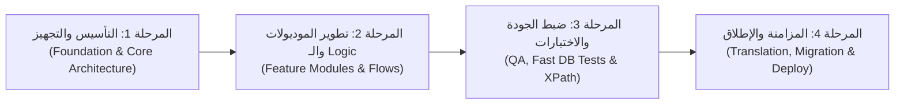

# Project Development Roadmap
# خارطة طريق ومراحل تطوير المشروع

**Project Name:** {project_name}  
**Target Version:** Odoo {version}.0  
**Status:** Active Development  

---

## 1. المراحل الرئيسية (Milestones)

---

## 2. تفاصيل المراحل وخطة العمل (Phase Breakdown)

### المرحلة 1: التأسيس والبنية التحتية (Foundation)
- [x] إعداد مساحة العمل والربط بمحرك Odoo {version} (`{project_name}.code-workspace`).
- [x] ضبط بورت السيرفر المخصص داخل `{project_name}.conf`.
- [x] تفعيل فاحص الـ Language Server (`odools.toml`) وخادم المعرفة (`.mcp.json`).

### المرحلة 2: تطوير وتعديل الموديولات (Feature Development)
- [ ] تطوير الموديولات وفق قواعد كسر التوافقية لـ Odoo {version}.
- [ ] فحص سلامة الواجهات وتعبيرات الـ XPath باستخدام `odoo-ai xpath-check`.
- [ ] التأكد من تسجيل الموديلات في ملفات الصلاحيات `ir.model.access.csv`.

### المرحلة 3: بوابات الجودة والفحص السريع (Quality & Testing)
- [ ] تشغيل الفحص السكوني السريع (`odoo-ai lint`).
- [ ] تشغيل اختبارات الداتابيز النظيفة في 3 ثوانٍ (`odoo-ai test -m <module> --fast`).
- [ ] أخذ نقطة استرجاع (Snapshot) للداتابيز قبل أي تعديل على البيانات (`odoo-ai db-snap save`).

### المرحلة 4: الترجمة والإطلاق (Release & Deployment)
- [ ] مسح وتحديث ملفات الترجمة (.po / .pot) باستخدام `odoo-ai i18n`.
- [ ] التحقق الشامل عبر طبيب المنظومة (`odoo-ai doctor`).

