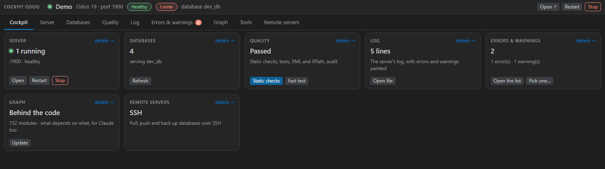
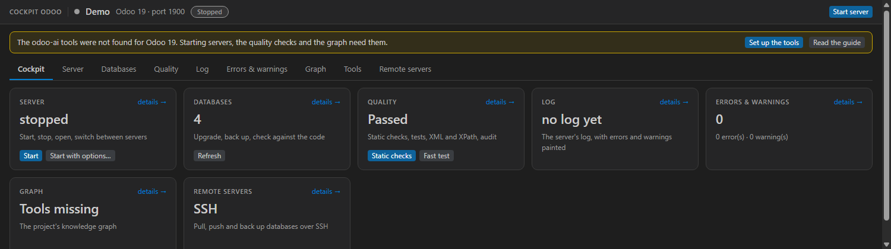
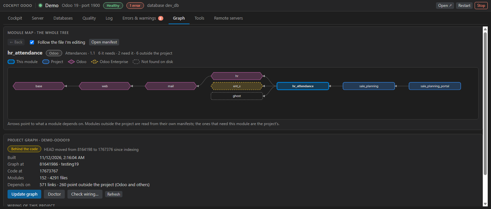
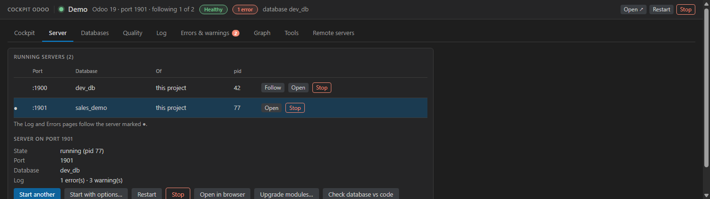
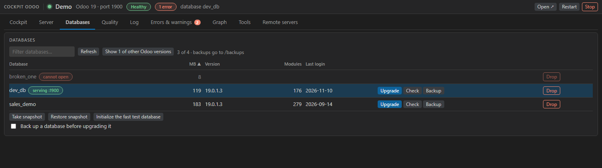
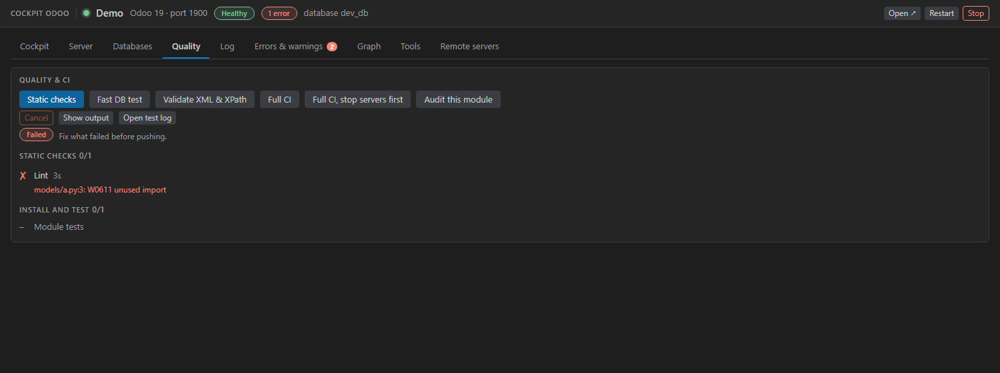
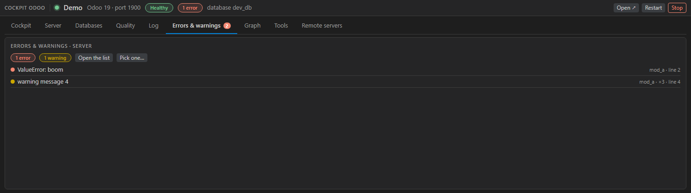
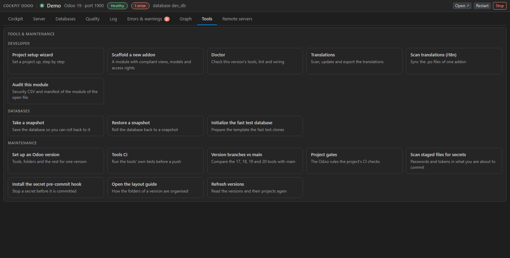
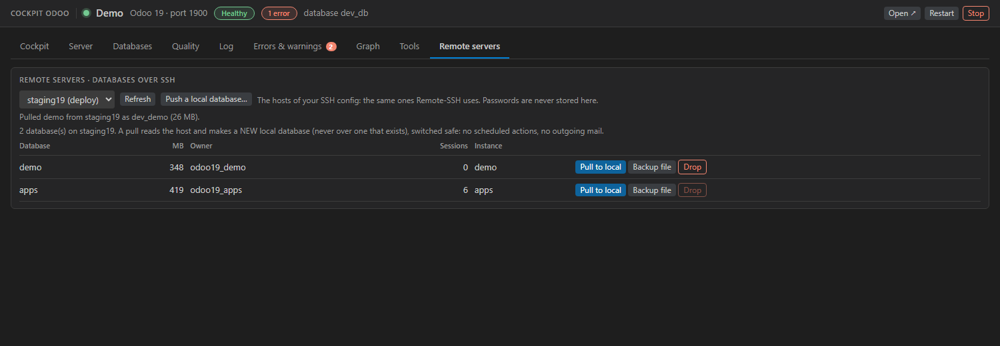
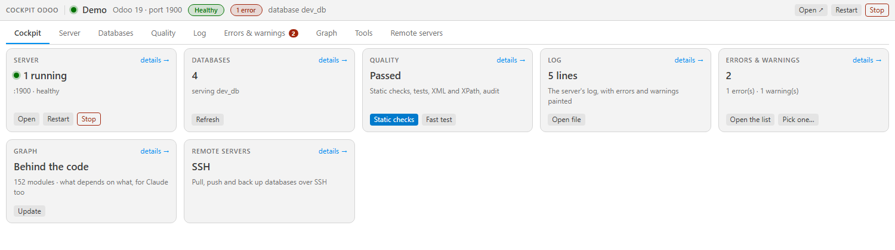

# Cockpit Odoo

**Run, test and inspect your Odoo projects from one panel in VS Code**: servers, databases, quality checks, errors linked to your code, the project's knowledge graph, and a map of the dependencies of the module you are editing.

It works on **any Odoo project**, whatever its layout. It is the face of a set of command-line tools (`odoo-ai`: the CI, the lint rules, the knowledge-graph engine, the database tools). Everything the cockpit does can also be done from a terminal, so the same work runs in CI and from an AI assistant; the cockpit is where you see it and press it.

> Pictures in this guide are made from sample data (a project called "Demo"), by the extension's own test suite.

## What you get

| | |
| --- | --- |
| **Servers** | Every Odoo server on the machine, however it was started (a terminal, a task, the debugger): follow one, open it, stop it, start another, start with options |
| **Databases** | Size, version, modules, last login; upgrade, back up, check against the code, drop; the modules of a database against the code on disk; snapshots |
| **Quality** | Static checks, a fast database test, XML and XPath validation, a full CI run, a module audit; the steps of the last run and why one failed |
| **Errors** | The errors and warnings of the running server, tied to your code: press one to open the file at the line |
| **Graph** | The project's knowledge graph, and the dependency tree of the module you are editing |
| **Tools** | Project setup, addon scaffolding, translations, secret scanning, and the maintenance of the tools themselves |
| **Remote** | Databases on a host of your SSH config: pull to a new local database, push, back up |

## Get started

1. **Install** the extension (`Extensions: Install from VSIX…`).
2. **Open an Odoo project folder** (any folder that holds addons with a `__manifest__.py`). Click the **Cockpit Odoo** icon in the Activity Bar, or run `Odoo Studio: Open Cockpit Odoo in the Bottom Panel`.
3. **If a notice at the top says the tools were not found**, press **Set up the tools** (see [What it needs](#what-it-needs)). The pages that run something (servers, quality, graph) need them.

## A tour of the pages

The sidebar is a short list: the project, the state of the server with its buttons (*Start*, *Stop*, *Restart*, *Open*), and one row for each page of the cockpit. The cockpit itself is one view in the bottom panel, beside Terminal and Problems.

### The map of the module you are editing

Open a file of any module and the **Graph** page draws the whole tree of what that module depends on, down to `base`, and the modules of your project that need it. It follows you from file to file.

- Modules from Odoo are **hexagons**, Odoo Enterprise ones hexagons with a dashed outline, third-party modules dashed, your project's own modules plain rectangles, and the module in the middle has a heavy outline. Shape and outline say what a module is, not colour alone.
- Press any module, also one of Odoo's, and its own whole tree is drawn. A module that is not in your project is read from its own `__manifest__.py`, which is read as data and never run. **Back** returns; **Open manifest** opens the file.
- The command **Show the Graph of This Module** brings the page up on the file you are in.
- Limits: the modules that need an Odoo module are your project's only, and a side is cut at 400 modules and says so.

### Servers

*Start never stops a server that is running*: a new one takes the next free port. *Restart* and *Stop* on the page act on the server marked with a dot only, so the others keep running.

### Databases

The page lists the databases of the project's Odoo version; those written by another version are hidden behind a button that says how many, and when shown they are dimmed and offer no upgrade. *Back up a database before upgrading it* makes the upgrade stop if the backup fails.

### Quality

### Errors and warnings

### Tools

### Remote servers

Passwords are never stored. A pull reads the host and makes a **new** local database (never over one that exists), switched safe: no scheduled actions, no outgoing mail.

### Light and dark

The cockpit uses the colours of your VS Code theme.

## What it needs

The cockpit calls `cli.py` of the `odoo-ai` tools. It looks for it, in this order:

1. the setting `odooCi.cliPath`;
2. `<root>/odoo<NN>/tools/cli.py` for the Odoo version of your project (then the one of Odoo 19), where `<root>` is the setting `odooCi.odooRoot`, else the environment variable `ODOO_ROOT`, else found from where the project is, else `C:\odoo` on Windows and `~/odoo` elsewhere.

The tools are the `tools` folder of the repository this extension belongs to (branch `<NN>.0` for Odoo NN). **Set up an Odoo version** (`odoo-ai new-version NN`) clones them, makes the folders and lists what you still download; its *Check only* mode changes nothing. **Run Odoo-AI Doctor Check** says what is missing and how to repair it.

**A project that does not follow the layout of the tools** is read for what it declares: the Odoo version comes from its manifests (`17.0.1.0.0` is Odoo 17), the server configuration is `<project>.conf` or `odoo.conf`, and the port is the one that file gives. The cockpit never assigns a port; a project in the layout of the tools keeps the port of its own `.conf`.

Windows is where it is tested. The code has paths for Linux and macOS, but they are not verified.

## Limits and safety

- **Windows only, in practice.** Everything was tested on Windows (the `C:\odoo\odoo<NN>` layout, PowerShell, `venv\Scripts`). Linux and macOS paths exist in the code and are not verified.
- **Trusted folders only.** The extension runs the project's Python, its scripts and its CI checks, so it declares that it does not support an untrusted workspace: VS Code asks you to trust the folder first.
- **Snapshots are exact.** `db-snap restore <label>` replaces the database only by the snapshot named exactly `snap_<db>_<label>`; it never guesses from part of a name, and the extension asks you to confirm first. Labels, module names and language codes you type are checked before they reach a command line.
- **Automatic translation sends text out.** The untranslated terms of a module are sent to the endpoint you configure. A model on your own machine (`localhost`) keeps them there; a hosted one receives them. The page says which one it is.
- **The graph is yours.** It is built per project, on your disk, and never committed.

## Settings

| Setting | Meaning |
| --- | --- |
| `odooCi.python` | The Python that runs `odoo-ai` (empty: the interpreter chosen for the workspace, else the version's own venv) |
| `odooCi.cliPath` | The CLI script (empty: the version's `tools/cli.py`) |
| `odooCi.version` | Force an Odoo version instead of reading it from the project |
| `odooCi.serverPort` | The port to open (empty: the project's configuration file) |
| `odooCi.odooRoot` | The folder that holds the `odoo<NN>` folders |
| `odooCi.backupDir`, `odooCi.backupBeforeUpgrade` | Where backups go, and whether an upgrade backs up first |
| `odooCi.graph.autoUpdate` | Update the graph quietly when the project opens and it is behind the code |
| `odooCi.graph.followEditor` | The module map follows the file you are editing |
| `odooCi.graph.keepGenerations` | Every graph update leaves an old generation on disk that the engine never removes. `0` (the default) deletes nothing; a number keeps the published one and that many of the newest |
| `odooCi.defaultLang`, `odooCi.i18n.*` | Translation languages, and a model of your own for automatic translation |
| `odooCi.maintainerTools` | Show the two commands for people who maintain these tools themselves (the tools' own CI, the 17/18/19/20 branches against main). Off by default |
| `odooCi.remoteSudoUser` | The one account a remote host opens to you for its databases |

## Privacy and safety

- Nothing is sent anywhere by the extension itself, and it collects no telemetry. What reaches another machine is what you ask for: remote databases over your own SSH, and (only when you set `odooCi.i18n.translatorUrl`) strings to translate sent to that endpoint.
- The page can start only the commands this extension declares, by name. Dropping a database asks first, in a window you must answer, and offers to back it up; an upgrade of a database another session is using warns you before it runs.
- A module's `__manifest__.py` is parsed as data; nothing in it is ever run.
- The cockpit's page runs under a strict content-security policy and builds its nodes from data, never from markup strings.

## Troubleshooting

| You see | Why, and what to do |
| --- | --- |
| *The odoo-ai tools were not found* | Press **Set up the tools**, or set `odooCi.cliPath` / `odooCi.odooRoot` |
| *Graph: Tools missing* or *Not built yet* | The first needs the tools; the second: press **Update graph** |
| *No graph config* | The project has not been wired to a graph: **Check wiring…** shows what would change before it does |
| The map says a module was *not found on disk* | It is declared in a manifest but its folder is not in the Odoo folders the cockpit knows |
| The wrong Odoo version | Set `odooCi.version` |

## Working on the extension

| File | Role |
| --- | --- |
| `extension.js` | Activation, commands, the sidebar, the server and CI runners |
| `cockpit.js` | The state the page draws, and what its buttons ask of the editor |
| `media/cockpit.html` | The page |
| `graph.js` | The Graph page: status, update, wiring, the map of a module |
| `project.js`, `detect.js`, `rulefixes.js` | Which project and version; finding running servers; the quick fixes |
| `remote.js`, `translations.js` | The Remote servers page and the Translations page |

To add a page: add its section and tab to `media/cockpit.html`, its state to `buildState` in `cockpit.js`, and a test. The tests are plain Node scripts (`node test/<name>.test.js`; the page is checked in a real Chrome when one is found), and `node test/cockpit_ui.test.js --shot <folder>` makes the pictures of this guide. A command the page starts by name must be declared in `package.json`; a test checks it. `build_vsix.py` packs the extension.

---

*MIT License · see [CHANGELOG](CHANGELOG.md)*
